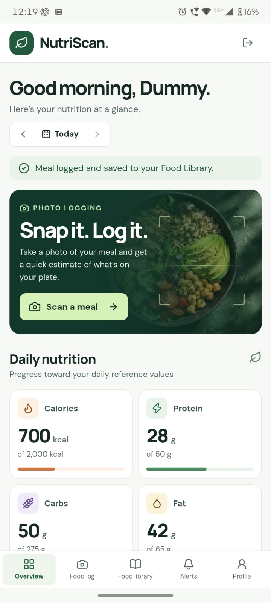
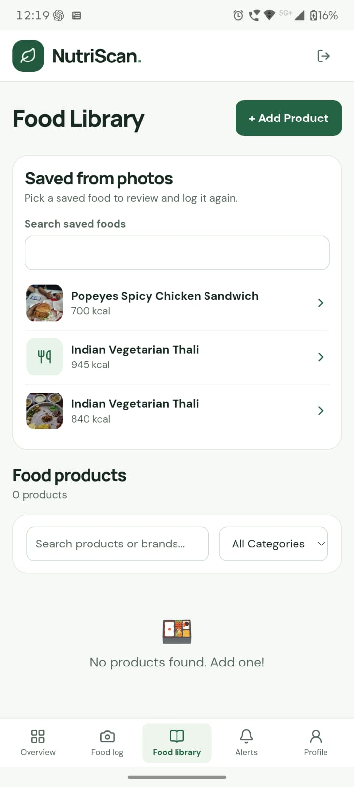
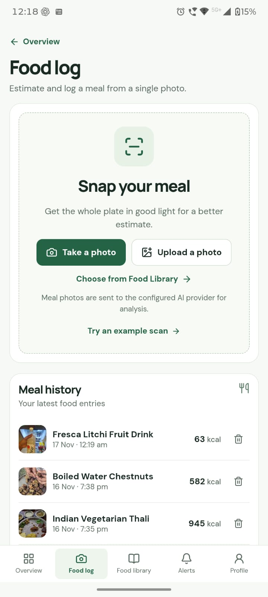
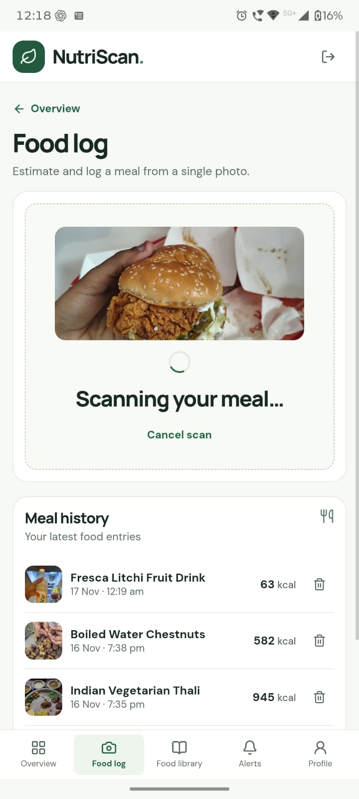
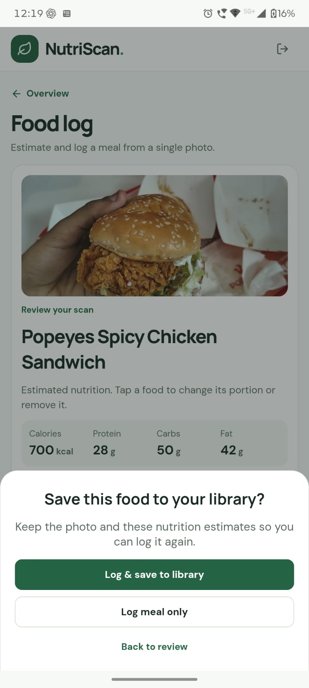
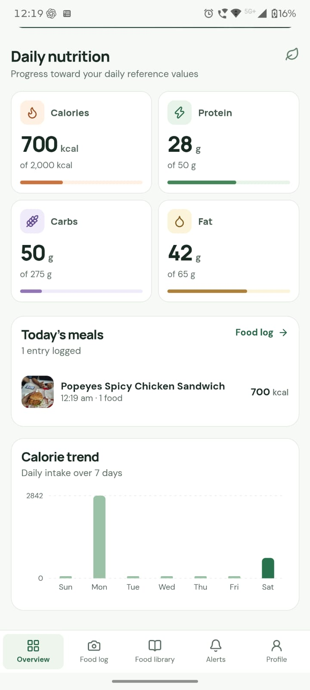
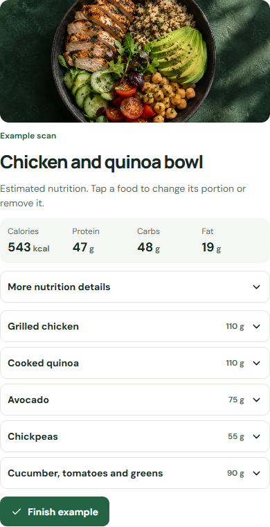

<div align="center">

# 🥗 NutriScan

### 📸 Snap it. 🧠 Review it. 🌿 Log it.

**Photo-based meal logging, nutrition tracking, and a reusable Food Library — on the web and Android.**

[](client/package.json)
[](package.json)
[](server/models)
[](android)

**[🚀 Open the live app](https://nutriscan-six-theta.vercel.app/)** · **[📷 Screenshot gallery](docs/screenshots/README.md)** · **[⚙️ Local setup](#run-locally)** · **[📱 Android setup](#build-for-android)**

**[📥 Download Android APK v1.1](https://drive.google.com/file/d/13xwcfWZrq6rTIV_z3KvcvCPLviKbS0kw/view?usp=sharing)** — open Google Drive and select **Download** to get `NutriScan-1.1.apk`.





</div>

---

## 💡 Why I built NutriScan

Tracking a meal can mean searching for every ingredient, estimating portions, and adding up the nutrients. Doing that several times a day makes the habit harder to maintain.

I built NutriScan to start with a meal photo, turn it into nutrition estimates, and let you review the result before logging. Meals you eat often can be saved with their photos and reused later. Athletes, gym-goers, and anyone curious about their eating habits can see how each meal contributes to their daily totals.

## ✨ What you can do

- **📸 Scan a meal:** take a photo or upload one for analysis using a configured Gemini or OpenAI provider.
- **🧠 Review the estimate:** answer short questions about uncertain foods or portions, or choose **Use the estimate**.
- **⚖️ Adjust before logging:** change portions, exclude foods, and review calories, protein, carbs, fat, fiber, sugar, and sodium.
- **📚 Save meals for next time:** choose **Log & save to library**, search saved meals by name or ingredient, and log them again with adjusted portions.
- **🍽️ Log products manually:** add food products with nutrition details, search by name or filter by category, and log servings with a date and time.
- **📊 Follow daily intake:** browse dates, see calories and macros against daily reference values, and view a seven-day calorie chart.
- **🕘 Revisit meal history:** see recent entries with stored meal photos and remove entries when needed.
- **👤 Maintain a health profile:** save height, weight, activity level, allergies, and health conditions; view BMI.
- **🔔 Review nutrition alerts:** see alerts when logged calories, sugar, sodium, or fat exceed the app's fixed daily references, and mark alerts as read.
- **🔐 Sign in your way:** use email/password or optional Google sign-in, including the native account picker in Android when configured.
- **📱 Use the same app on Android:** the native WebView shell adds camera/file selection, Google sign-in, and a configurable server address.

> 📝 Photo analysis produces estimates. Review food identities and portions before saving. Dashboard reference values are fixed in the current implementation; they are not personalized from the health profile.

## 🗺️ From photo to food log

1. **🔑 Sign in** or create an account in the [live app](https://nutriscan-six-theta.vercel.app/login).
2. **📸 Open Food log** and choose **Take a photo** or **Upload a photo**. The Vercel build accepts originals up to **4 MB**; the default local build allows **10 MB**.
3. **💬 Check the scan.** Answer any follow-up questions, then review the estimated foods and portions.
4. **✅ Add to dashboard.** Choose **Log & save to library** to reuse the meal, or **Log meal only**.
5. **📈 Check your totals.** The dashboard updates the meal list and daily nutrition; recent entries also appear in Meal history.
6. **♻️ Reuse a favorite.** Open **Food Library → Saved from photos**, search for a meal, review it, and log it again.

💡 **Try an example scan** opens a built-in review example without running photo analysis. Finish the example to explore the interface; it does not log a real meal.

## 📷 A closer look

### 📸 Capture → analyze → clarify

<p align="center">
  
  
  
</p>

### 💾 Save once, log again

<p align="center">
  
  
</p>

### 🥑 Food details in the web interface

<p align="center">
  
  
</p>

Browse the **[full screenshot gallery](docs/screenshots/README.md)** for sign-in screens and every recovered screenshot. The two web detail images were already in the repository; the Android screenshots show a recorded app session.

## 🎨 Design

Forest green (`#246445`), soft off-white (`#F7F9F6`), white cards, and food photography give the app its visual identity. **Manrope** headings and **DM Sans** body text keep meal names, portions, and nutrition totals easy to scan. Responsive layouts support both desktop browsers and phone screens.

## 🧰 Tech stack

- **🖥️ Frontend:** React 18, React Router 6, Axios, Recharts, Lucide React, and Create React App.
- **⚙️ Backend:** Node.js, Express 4, JWT authentication, and bcrypt password hashing.
- **🗄️ Storage:** MongoDB with Mongoose models for accounts, health profiles, products, meal records, meal photos, saved foods, daily intake, alerts, and Google sign-in flows.
- **🧠 Photo analysis:** server-side Gemini and OpenAI integrations with structured meal estimates. **Gemini takes priority when both API keys are set**; the app does not automatically fail over between providers.
- **🤖 Android:** Java, Android WebView, AndroidX Credential Manager, and Gradle. Minimum Android version: **7.0 / API 24**.
- **☁️ Deployment:** Vercel serves the React build and forwards `/api` requests to an Express serverless handler.

## 🏗️ Project structure

```text
nutriscan/
├── client/
│   ├── public/             # Web entry page
│   └── src/
│       ├── components/     # Camera, saved foods, layout, sign-in, photos
│       ├── context/        # Authentication state
│       ├── pages/          # Dashboard, food log, library, alerts, profile
│       └── utils/          # API client, meal dates, example meal
├── server/
│   ├── middleware/         # Authentication middleware
│   ├── models/             # Mongoose schemas
│   ├── routes/             # Express API routes
│   ├── app.js              # Middleware, API routes, production web serving
│   ├── database.js         # MongoDB connection
│   └── index.js            # Local server startup
├── android/                # Native Android WebView application
├── api/handler.js          # Vercel API entry point
├── scripts/build-vercel.js # Hosted build with the 4 MB photo limit
├── docs/screenshots/       # Screenshots and gallery
├── .env.example            # Backend configuration template
└── vercel.json             # Build and routing configuration
```

The React client and Android WebView use the same Express API. Scans go from the backend to the selected AI provider; logged meals and original photos are stored through the backend in MongoDB.

<a id="run-locally"></a>

## 🚀 Run locally

### 1️⃣ Prerequisites

- Node.js **20 or later** and npm.
- A running local MongoDB instance or a reachable MongoDB Atlas database.
- A Gemini **or** OpenAI API key to analyze real photos. Manual product logging and the built-in example do not need a vision API key.

### 2️⃣ Clone and install

```sh
git clone https://github.com/Kunalsingh7116-git/nutriscan.git
cd nutriscan
npm ci
npm ci --prefix client
```

### 3️⃣ Configure the backend

Copy [`.env.example`](.env.example) to `.env` in the repository root:

```powershell
# Windows PowerShell
Copy-Item .env.example .env
```

```sh
# macOS / Linux
cp .env.example .env
```

Set these values:

- **`MONGODB_URI`** — your database connection string, for example `mongodb://127.0.0.1:27017/NutriScanDB` for a local database.
- **`JWT_SECRET`** — a long, randomly generated secret for signing authentication tokens.
- **`PORT`** — `5000` matches the React development proxy.
- **`NODE_ENV`** — `development` for the two-server development setup below.
- **`GEMINI_API_KEY` or `OPENAI_API_KEY`** — enables real photo scans. Optional `GEMINI_VISION_MODEL` and `OPENAI_VISION_MODEL` select the model used by each integration; the checked-in defaults are in `.env.example`.

🔐 Keep database credentials, JWT secrets, provider keys, and Google client secrets in the backend environment. The repository ignores `.env` files except `.env.example`.

### 4️⃣ Start development

```sh
npm run dev
```

Open **[localhost:3000](http://localhost:3000)**. The API runs at `http://localhost:5000`; the frontend proxies `/api` requests to it. Register an account, then open **Food log**.

### 📦 Run the production build locally

Set `NODE_ENV=production` in `.env`, then run:

```sh
npm run build
npm start
```

Open **[localhost:5000/login](http://localhost:5000/login)**. Express serves the compiled React app and the API from one origin.

### 🛠️ Available commands

- `npm run dev` — starts the API and React development server together.
- `npm run server` — starts the API with automatic restart through nodemon.
- `npm run client` — starts only the React development server.
- `npm run build` — creates `client/build`.
- `npm run build:vercel` — builds the frontend with the hosted 4 MB photo limit.
- `npm start` — starts Express; build the client first when serving it in production mode.

<a id="build-for-android"></a>

## 📱 Build for Android

The Android app loads a hosted NutriScan server; it requires a reachable backend and database. The source currently declares app version **1.1**. A prebuilt **[NutriScan 1.1 APK](https://drive.google.com/file/d/13xwcfWZrq6rTIV_z3KvcvCPLviKbS0kw/view?usp=sharing)** is hosted on Google Drive; open the link and choose **Download**. To build from source, follow the steps below.

1. Install **JDK 17** and **Android SDK Platform 34**. Set up the Android SDK location for your environment.
2. From the repository root, build a debug APK:

   ```powershell
   cd android
   .\gradlew.bat assembleDebug "-PnutriscanServer=https://nutriscan-six-theta.vercel.app"
   ```

   On macOS or Linux, run from `android/`:

   ```sh
   ./gradlew assembleDebug -PnutriscanServer=https://nutriscan-six-theta.vercel.app
   ```

3. Install `android/app/build/outputs/apk/debug/app-debug.apk` on a phone or emulator.
4. To change the server, press **Back** when there is no browser history and choose **Change server**. Use an HTTPS deployment, your computer's private Wi-Fi address such as `http://192.168.1.8:5000`, or `http://10.0.2.2:5000` from the Android Emulator.

For local Android testing, use the single-origin production build described above so the same server serves both the web interface and API.

## 🔑 Optional Google sign-in

Email/password authentication works without Google OAuth configuration. To enable Google sign-in:

1. Create a Google OAuth **Web application** client.
2. Register the exact callback URL for your server, for example `http://localhost:5000/api/auth/google/callback` locally or `https://YOUR-DOMAIN/api/auth/google/callback` for deployment.
3. Set **`GOOGLE_CLIENT_ID`**, **`GOOGLE_CLIENT_SECRET`**, and **`GOOGLE_REDIRECT_URI`** on the backend. Use the same server origin users open in the app.
4. For the Android native account picker, also create an **Android** OAuth client in the same Google Cloud project with package name **`com.nutriscan.mobile`** and the SHA-1 fingerprint of the certificate signing the APK. Keep the backend `GOOGLE_CLIENT_ID` set to the **Web application** client ID.

## ☁️ Deploy on Vercel

1. Import this GitHub repository and keep the Vercel root directory at the repository root.
2. Use the checked-in [`vercel.json`](vercel.json), which installs both dependency sets, builds the frontend, and routes API requests to [`api/handler.js`](api/handler.js).
3. Add **`MONGODB_URI`**, **`JWT_SECRET`**, and a vision provider API key to the Vercel environment. The database must be reachable from the deployed backend.
4. Add the Google OAuth environment values if you want Google sign-in, using the deployment's exact callback URL.
5. Deploy, then verify registration/sign-in, a real scan, meal logging, and library reuse.

## 🧩 Troubleshooting

- **The API exits before starting:** check that `MONGODB_URI` is correct and MongoDB is reachable.
- **Photo analysis asks for setup:** configure a Gemini or OpenAI API key and restart or redeploy the backend.
- **A provider rejects a scan:** check credentials, configured model access, and provider quota. These settings are read on the server.
- **A photo is rejected:** use a smaller original image; the hosted build limits originals to 4 MB. JPEG, PNG, and WebP are the safest choices. The picker also accepts HEIC/HEIF, but previewing those formats depends on browser support.
- **Camera capture is unavailable in the browser:** try HTTPS or localhost, grant camera permission, or use **Upload a photo**.
- **Google sign-in fails:** check the web client configuration, callback origin, and, on Android, the signing certificate fingerprint.

## 🤝 Contributing

Ideas and fixes are welcome through [GitHub issues](https://github.com/Kunalsingh7116-git/nutriscan/issues) and pull requests. Keep changes focused, describe the behavior you changed, and include screenshots for interface updates. Run `npm run build` when changing the frontend.

## 👨‍💻 About the author

Built by **[Kunal Singh](https://github.com/Kunalsingh7116-git)**, an undergraduate at **NSUT**, as a personal open source project to make meal tracking easier to keep up with.

<div align="center">

**🥗 A photo to start. A clearer food log to keep going.**

[🚀 Try NutriScan](https://nutriscan-six-theta.vercel.app/) · [🐛 Report an issue](https://github.com/Kunalsingh7116-git/nutriscan/issues)

</div>
