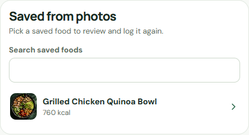

# NutriScan

**A photo-based meal tracker for athletes, gym-goers, and anyone who wants a clearer view of what they eat.**

[Try the live app](https://nutriscan-six-theta.vercel.app/login) · [See the walkthrough](#see-it-in-action) · [Install and run](#install-and-run) · [Tech stack](#what-i-built-it-with) · [About me](#about-me)

## Why I built it

When you're training, tracking what you eat can turn into a list of ingredients, portion sizes, and numbers to add up. I wanted to make it easier to keep track of calories, protein, carbs, and fat without looking up every item by hand.

I built NutriScan around a meal photo. The app estimates the foods, portions, and nutrients, and you can adjust those estimates before logging the meal. I added the Food Library so you can reuse meals you eat regularly and a dashboard to show how each meal contributes to your daily totals.

If you train, you can use those daily totals to track what you eat around workouts. If you just want to understand your eating habits, the same meal history and weekly calorie trend give you a place to start.

## What you can do

- **Log meals from a photo or enter them manually.** Review the foods and portion estimates before saving.
- **Reuse meals from your Food Library.** Save a meal's photo and nutrition details, then search for it by name or ingredient and log it again.
- **See your meals and daily totals.** Meal History shows the original photo when available. The dashboard shows daily nutrition and a seven-day calorie trend.
- **Keep a health profile.** Save your height, weight, activity level, allergies, and health conditions.

## See it in action

### 1. Sign in and open Food log

Open the [live site](https://nutriscan-six-theta.vercel.app/login), then register or sign in. In **Food log**, choose **Take a photo** or **Upload a photo**. On the hosted site, choose an original image up to 4 MB.

### 2. Check the scan

Answer any follow-up questions or choose **Use the estimate**. Check the foods and adjust portions before logging. To see what the review screen looks like, choose **Try an example scan**.


### 3. Log the meal and decide whether to save it

On a real scan, choose **Add to dashboard**, then **Log & save to library** to keep the meal for reuse or **Log meal only** to add it to your history.

### 4. Reuse a saved meal

Open **Food Library → Saved from photos**, search by meal name or ingredient, and select the meal. Review the portions and choose **Add to dashboard** to log it again.



### 5. Check your history and daily totals

Go to **Food log → Meal history** to check the original photo on the meal entry. The dashboard shows how the meal contributes to your daily totals.

## Install and run

### Run the web app locally

1. Install Node.js 20 or later. Start MongoDB locally or have a MongoDB connection string ready.
2. Clone the repository and install the dependencies.

   ```sh
   git clone https://github.com/Kunalsingh7116-git/nutriscan.git
   cd nutriscan
   npm ci
   npm ci --prefix client
   ```

3. Copy [`.env.example`](.env.example) to `.env`. Set `MONGODB_URI` and a long random `JWT_SECRET`. Set `NODE_ENV=production` and keep `PORT=5000` for the local address below. To enable photo analysis, set `GEMINI_API_KEY` or `OPENAI_API_KEY`. Keep secrets in the backend environment.
4. Build and start the project.

   ```sh
   npm run build
   npm start
   ```

5. Open [the local sign-in page](http://localhost:5000/login). Register or sign in, then go to **Food log**.

### Run on Android

1. Install JDK 17 and Android SDK Platform 34. From the repository root on Windows, build a debug APK using the included Gradle wrapper.

   ```powershell
   cd android
   .\gradlew.bat assembleDebug "-PnutriscanServer=https://nutriscan-six-theta.vercel.app"
   ```

   On macOS or Linux, run `./gradlew assembleDebug -PnutriscanServer=https://nutriscan-six-theta.vercel.app` from the `android` folder.
2. Install `android/app/build/outputs/apk/debug/app-debug.apk` on your phone or emulator. Open NutriScan and sign in.
3. To use a different server, press Back from the first screen and choose **Change server**. For a local server, use your computer’s Wi-Fi address and port on a physical phone, or `http://10.0.2.2:5000` on the Android Emulator.

### Hosting and sign-in

To deploy, import the repository into Vercel and keep the root directory at the repository root. The checked-in [Vercel configuration](vercel.json) builds the React app and routes API requests to Express. Add a reachable `MONGODB_URI`, a `JWT_SECRET`, and a photo analysis key to the Vercel project environment.

Google sign-in is optional. Configure a Google OAuth **Web application** client and register the exact `/api/auth/google/callback` URL for the server your users open. Set `GOOGLE_CLIENT_ID`, `GOOGLE_CLIENT_SECRET`, and `GOOGLE_REDIRECT_URI` on the backend.

For Android’s native Google account picker, create an **Android** OAuth client in the same Google Cloud project as the web client. Use package name `com.nutriscan.mobile` and the SHA-1 fingerprint of the certificate used to sign the APK. Keep `GOOGLE_CLIENT_ID` set to the **Web application** client ID on the HTTPS backend. [Android Google sign-in setup](https://developer.android.com/identity/sign-in/credential-manager-siwg-implementation)

## What I built it with

- **React** for the interface and **Android WebView** for the Android app. Both use the same screens and backend.
- **Node.js and Express** for the API and **MongoDB with Mongoose** for accounts, meals, photos, and saved foods.
- **Gemini or OpenAI** for photo analysis, depending on the backend configuration.
- **Gradle** for Android builds and **Vercel** for the web deployment configuration.

## About me

I’m **Kunal Singh**, an undergraduate at **NSUT**. NutriScan is my personal open course project. I built it to make everyday meal tracking easier to keep up with. [My GitHub profile](https://github.com/Kunalsingh7116-git)
