# 📷 NutriScan screenshot gallery

[← Back to the project README](../../README.md)

## 📱 Android walkthrough

These 10 original PNGs were recovered from the attached screenshot set. Files retain their original pixels with descriptive filenames. The source chat referenced 18 attachments; the other eight were unavailable to this update and are not included here.

### 🔐 Email and Google sign-in

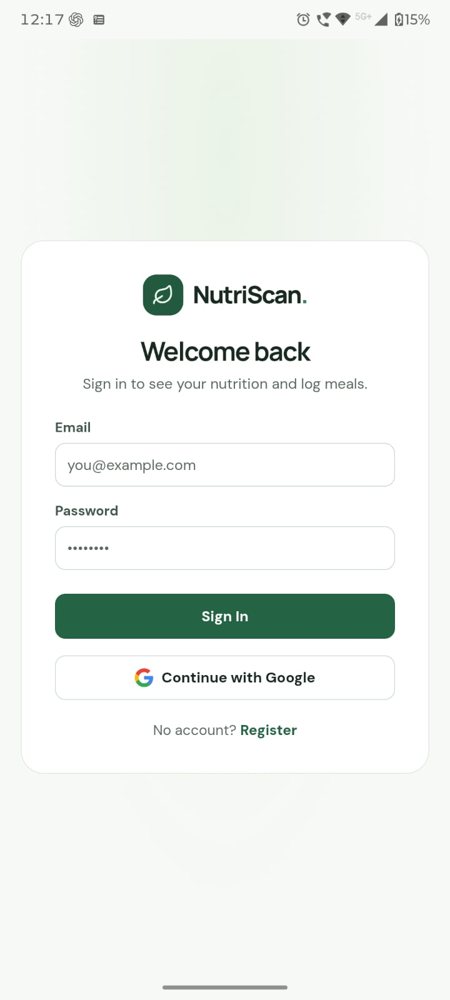

Original attachment: `image(20261120-185533).png`.

### 🔑 Native Google account picker

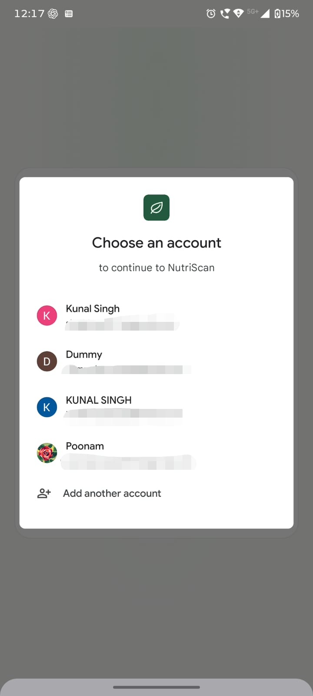

Original attachment: `image(20261120-185526).png`.

### 📸 Start a food log

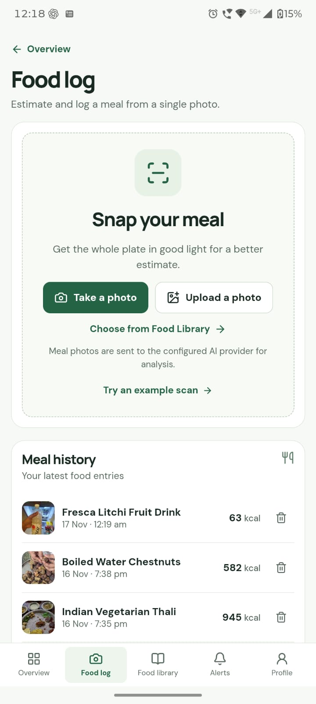

Original attachment: `image(20261120-185521).png`.

### 🧠 Analyzing a meal photo

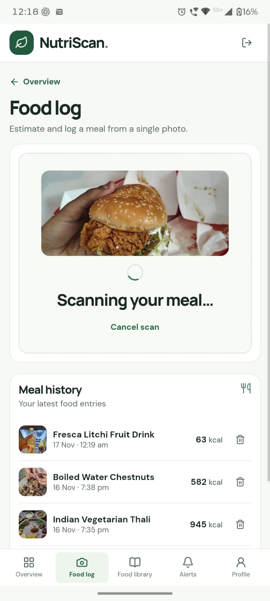

Original attachment: `image(20261120-185515).png`.

### 💬 Clarify the food estimate

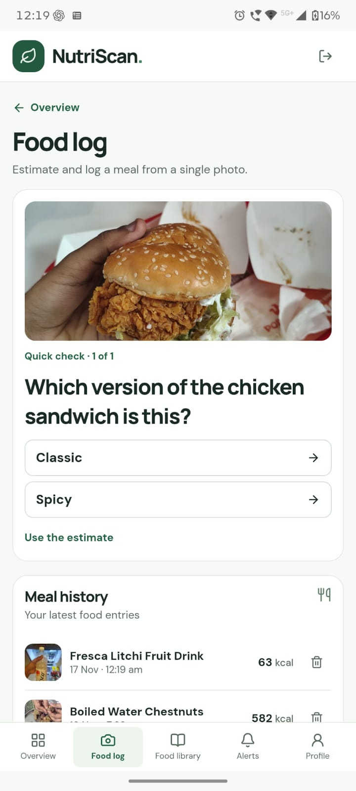

Original attachment: `image(20261120-185508).png`.

### ⚖️ Review nutrition and portions

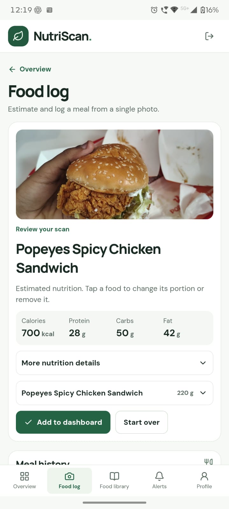

Original attachment: `image(20261120-185502).png`.

### 💾 Choose how to save

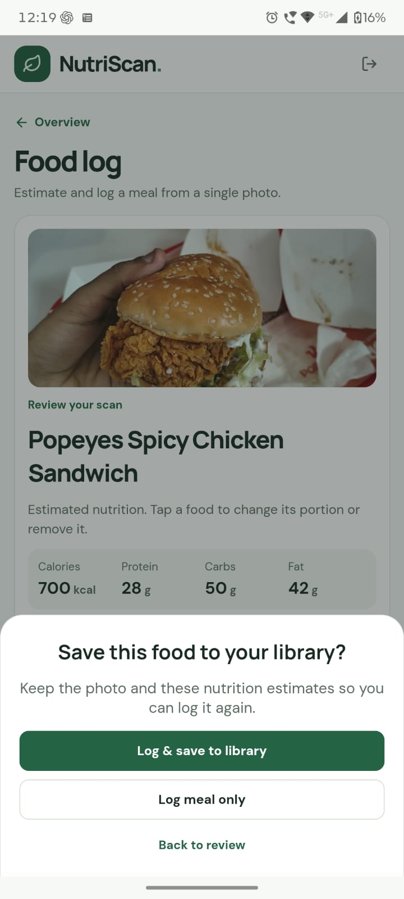

Original attachment: `image(20261120-185447).png`.

### 🌿 Nutrition overview

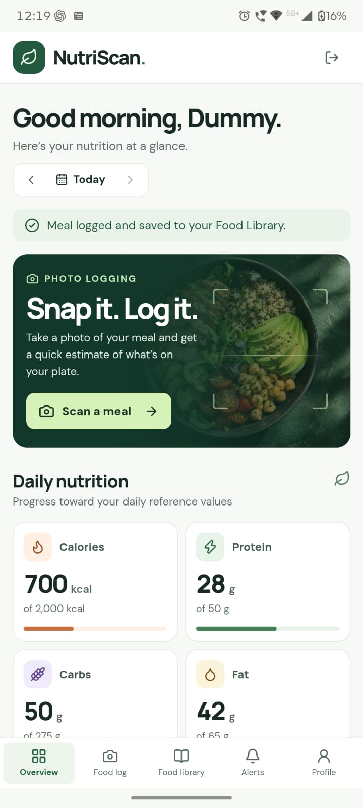

Original attachment: `image(20261120-185441).png`.

### 📈 Daily totals and calorie trend

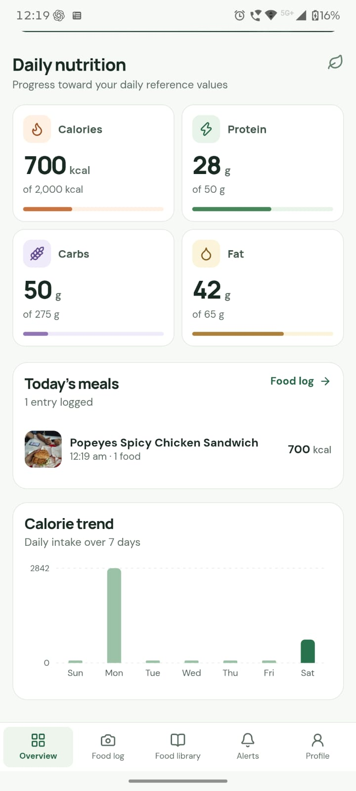

Original attachment: `image(20261120-185437).png`.

### 📚 Saved meals and food products

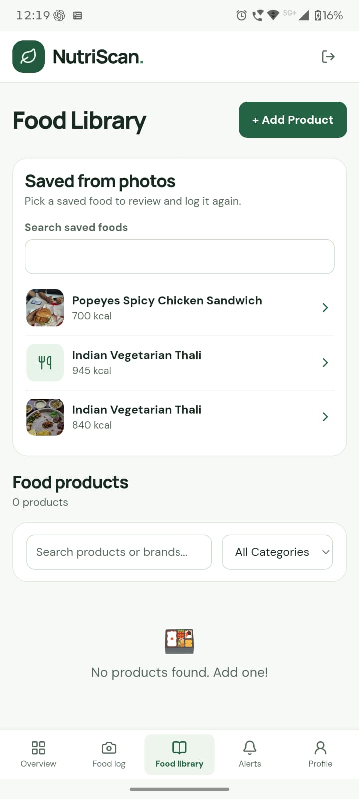

Original attachment: `image(20261120-185430).png`.

## 🖥️ Existing web interface details

### 🥗 Built-in example meal review

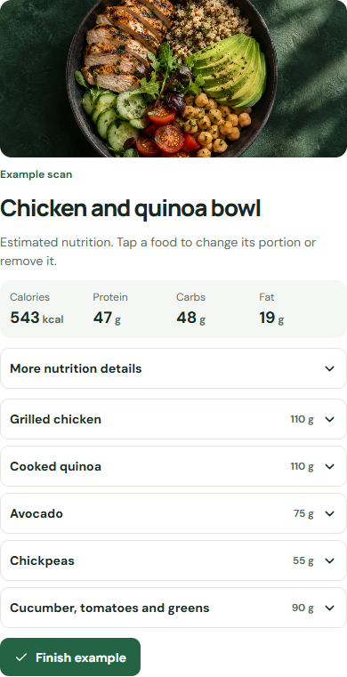

### ♻️ Saved foods component

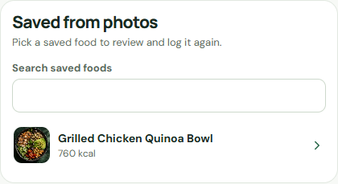
